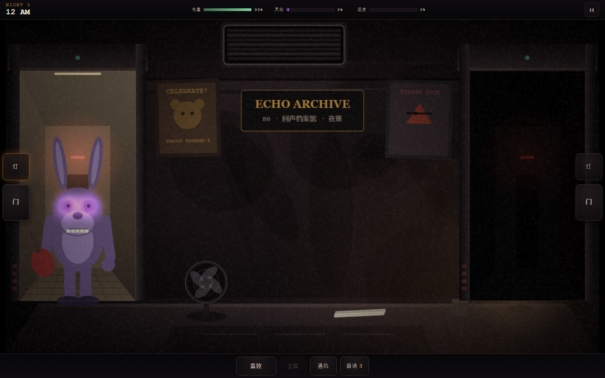
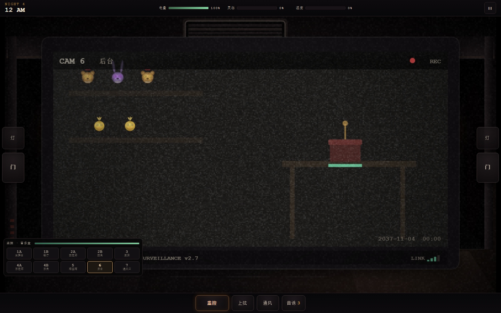

# 玩具熊的五夜：残响档案
### FIVE NIGHTS AT FAZBEAR'S · ECHO ARCHIVE

一款 FNAF 同人恐怖生存游戏，**单机、零依赖、零外部素材**：所有画面由 Canvas 程序化绘制，
所有音效由 Web Audio 实时合成，双击 `index.html` 即玩，电脑与手机浏览器通用。

> 非商业同人作品。与 Scott Cawthon、Steel Wool Studios 无隶属关系。
> 未使用任何官方素材，角色与场景均为本作原创设计，致敬原作玩法与叙事结构。

---

## 下载 / 试玩

| 方式 | 说明 |
|---|---|
| **在线试玩** | <https://thudou.github.io/fnaf-echo-archive/> （手机可直接玩） |
| **单文件版** | [fnaf-echo-archive.html](https://github.com/THUDou/fnaf-echo-archive/releases/latest/download/fnaf-echo-archive.html) —— 134 KB，一个 HTML 文件，双击即玩，无需安装 |
| **完整包** | [FNAF-Echo-Archive-v1.0.0.zip](https://github.com/THUDou/fnaf-echo-archive/releases/latest/download/FNAF-Echo-Archive-v1.0.0.zip) —— 单文件版 + 可读源码 |

**安卓 / iOS**：把 `.html` 下载到手机，用 Chrome / Safari 打开即可（存档保存在浏览器本地）。

---

## 截图

| 主菜单 | 办公室 |
|---|---|
|  |  |

---

## 一、运行

| 方式 | 操作 |
|---|---|
| 最简单 | 双击 `dist/fnaf-echo-archive.html`（单文件版）或 `index.html`（源码版） |
| 本地服务器（推荐手机同网访问） | 在 `fnaf-echoes/` 下执行 `python -m http.server 8080`，浏览器打开 `http://localhost:8080` |
| 重新构建单文件版 | `node tools/build.js` |
| 手机 | 与电脑同一 WiFi，访问 `http://<电脑IP>:8080`，建议横屏 + 耳机 |

**进度**保存在本机 `localStorage`，换浏览器或清缓存会丢失。

---

## 二、故事

2037 年，超级披萨广场废墟清理完毕。一批"无法归档"的残件被转运到地下六层的
**回声档案馆（ECHO）**——这里不修复玩偶，只让它们把记忆播完，然后断电。

你是第 7 任夜班档案员。工作内容：**活到早上六点**。

主线 5 夜 + 自定义夜。每夜约 4 分钟，通关解锁下一夜与对应的历史档案。

---

## 三、操作

### 电脑
| 键 | 功能 | 键 | 功能 |
|---|---|---|---|
| `Q` / `E` | 左 / 右 门闸 | `A` / `D` | 左 / 右 门灯 |
| `Space` | 监控开合 | `W` | 通风挡板 |
| `F` | 音频诱饵 | `1`–`0` | 切换 10 路摄像头 |
| 按住 `S` | 上弦（需停在 6 号机） | `Esc` | 暂停 |

### 手机 / 平板
- 屏幕左右两侧：灯、门（拇指位）
- 底部：监控 / 上弦（长按）/ 通风 / 音诱
- 监控打开后，点左下角机位格切换摄像头
- 金灵出现时，长按屏幕中央的「注视」

---

## 四、三条资源（核心压力）

| 资源 | 机制 | 归零/满值后果 |
|---|---|---|
| **电量** | 基础耗电 + 每个开启设备叠加（门 1.0、监控 1.0、灯/通风 0.5） | 停电：闸板全开、监控失效，约 10 秒后必死 |
| **灵怨** | 人偶堵门 / 堵通风口 / 残响占屏时上涨；无人靠近时缓慢回落 | 满 100：闸板被强制弹开、画面欺骗你 2.6 秒 |
| **温度** | 两扇门同时关 → 快速升温；全开 → 降温 | 满 100：散热过载，闸板锁死 4 秒并扣 10% 电 |

**设计意图**：电量惩罚"什么都开着"，温度惩罚"堵门流"，灵怨惩罚"一直盯着监控"。
三条线互为反制，逼迫玩家在"看 / 不听 / 不开门"之间做取舍，而不是背流程。

---

## 五、七件残件（AI 行为）

| 人偶 | 路线 | 应对 |
|---|---|---|
| **费兹**（棕熊） | 主舞台 → 餐厅 → 东廊 → 东角 → 右门 | 关右门；**你不看它时才移动** |
| **弹簧**（紫兔） | 主舞台 → 餐厅 → 西廊 → 西角 → 左门 | 关左门，移动最快 |
| **琪可**（黄鸡） | 主舞台 → 餐厅 → 厨房 → 东廊 → 通风口 | 关通风挡板可逼退；厨房只有声音 |
| **海盗狐** | 海盗湾四段蓄力 → 冲刺 | 2.1 秒内关右门；盯住 5 号机可拖延 |
| **提线**（傀儡） | 后台礼品盒 | 音乐盒归零后约 9.5 秒必杀，只能上弦阻止 |
| **残响**（故障） | 随机摄像头 | 不杀人，只污染画面、推高灵怨 |
| **金灵**（金色残响） | 第五夜起，灵怨 > 72 时出现 | 长按「注视」3 秒驱散，否则 7.5 秒后死亡 |

其他手段：**音频诱饵**每夜 3 次，把附近的人偶往回推 2 格并降灵怨。

---

## 六、难度与结局

| 夜 | 费兹 | 弹簧 | 琪可 | 狐 | 提线 | 残响 | 金灵 |
|---|---|---|---|---|---|---|---|
| 1 | 2 | 1 | 1 | 0 | 2 | 1 | – |
| 2 | 4 | 3 | 3 | 2 | 4 | 2 | – |
| 3 | 6 | 5 | 5 | 4 | 6 | 3 | – |
| 4 | 8 | 7 | 7 | 6 | 8 | 4 | – |
| 5 | 10 | 9 | 9 | 8 | 10 | 5 | 4 |
| 6 | 自定义 0–20 × 6 + 金灵开关 | | | | | | |

第五夜按**灵怨峰值**给出三种结局：

- 峰值 < 55 → **旁观者**（几乎没让它们确认你的存在）
- 55–84 → **档案员**
- ≥ 85 → **被记住的人**

---

## 七、档案库（18 条，跨作品设定梳理）

通关逐夜解锁，标签区分来源：

- **官方正典**：1983 咬人事件、1985 失踪儿童、1987 玩具系列与"87之咬"、1993 第一夜、
  弹簧锁密室、三十年后恐怖屋、地下控制室、模拟披萨店大火、无尽之夜、超级披萨广场、废墟
- **影视宇宙**：2023 / 2025 两部电影的平行时间线
- **官方小说**：《惊悚故事》的缝合怨灵
- **同人衍伸**：Candy's / POPGOES / JR's / 自制夜与速通文化
- **本作原创**：回声档案馆、残响学（灵怨值的由来）、七件残件谱

设计上刻意混合"会走动的"（费兹 / 弹簧 / 琪可 / 狐）与"不走动的"
（提线只在音乐盒归零后出现、残响只污染画面、金灵只是站着），
让威胁来源不全是"走廊里的脚步声"。

---

## 八、技术实现

| 层 | 说明 |
|---|---|
| `js/lore.js` | 档案文本、每夜简报与"电话人"留言 |
| `js/audio.js` | Web Audio 合成：风扇底噪、门闸、脚步（左右声像）、静电、尖叫、六点钟声、音乐盒、过载警报 |
| `js/art.js` | Canvas 矢量绘制：办公室、走廊透视、10 路监控、7 个人偶、7 段房间场景、CRT 噪点/扫描线/色散、Jumpscare |
| `js/game.js` | 状态机、资源结算、人偶 AI、存档、UI 与输入 |

- 无框架、无构建、无网络请求，全部资源在运行时生成。
- 渲染固定 1280×720 内部分辨率，`object-fit: contain` 适配任意屏幕。
- 设置里提供**减少闪烁**（关闭 Jumpscare 红闪与过载白闪），照顾光敏人群。

---

## 九、已知限制

- 无配音，全部为程序化音效与文字叙事。
- 手机竖屏可玩但视野偏小，建议横屏。
- 10 路监控画面为程序化场景，重复度高，靠人偶位置与噪点区分。
- 自定义夜难度上限 20，未做"20/20/20/20 四熊同屏"的特殊演出。

---

## 十、免责声明

本作是非商业性质的同人创作，仅用于学习与交流。FIVE NIGHTS AT FREDDY'S 及相关名称、
角色版权归 Scott Cawthon 所有。本项目未包含、未分发任何官方美术、音频或代码资源；
如版权方有异议，将立即停止分发。
